<div align="center">

<a href="https://code-shelf-eight.vercel.app">
  
</a>

<br/>

<a href="https://code-shelf-eight.vercel.app"></a>

<br/><br/>


<br/>

<sub>
  <a href="#-see-it-in-action">Demo</a> ·
  <a href="#-features">Features</a> ·
  <a href="#-architecture">Architecture</a> ·
  <a href="#-engineering-highlights">Engineering</a> ·
  <a href="#-run-it-locally">Run locally</a>
</sub>

</div>

<br/>

> **The problem:** you solve a sliding-window problem, learn a SQL window function, fix a Docker volume bug — and three weeks later it's gone.
> **CodeShelf** turns everything you learn into an AI-generated, spaced-repetition recall system that comes back to you — on screen, in your headphones, offline, and in your inbox.

<br/>

## 🎬 See it in action

<div align="center">
  <a href="https://code-shelf-eight.vercel.app">
    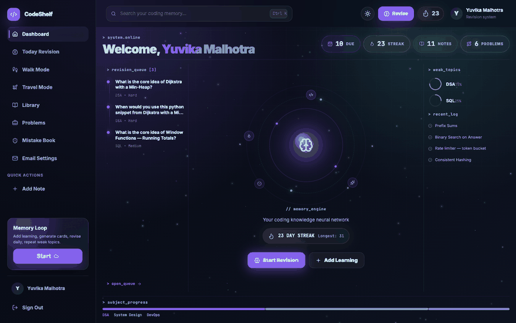
  </a>
  <sub>Live at <a href="https://code-shelf-eight.vercel.app"><b>code-shelf-eight.vercel.app</b></a> — sign up in seconds. <i>First request may take ~30s while the free-tier API wakes up.</i></sub>
</div>

<br/>


<br/>

## ✨ Features

<table>
  <tr>
    <td width="50%" valign="top">
      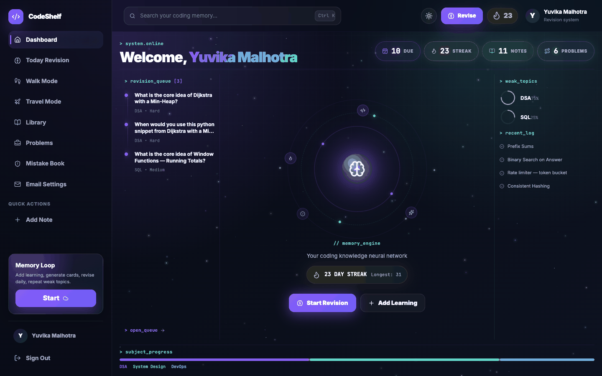
      <h3>🛰️ Command-center dashboard</h3>
      Due cards, streak, weak-topic rings and a live revision queue — everything you should revise today on one screen.
    </td>
    <td width="50%" valign="top">
      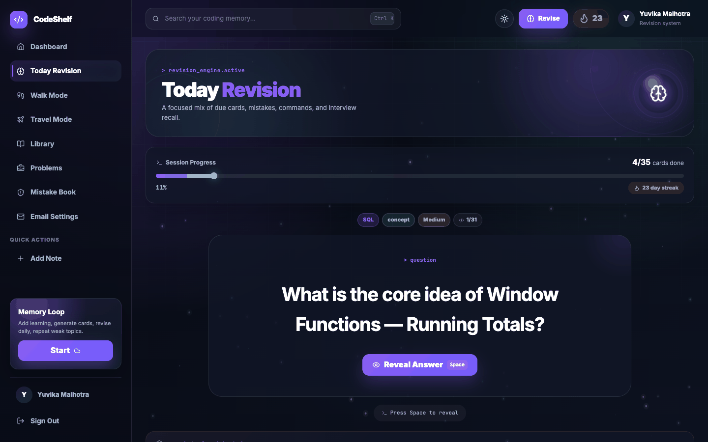
      <h3>🧠 Spaced-repetition engine</h3>
      Rate each card <kbd>1</kbd> Again · <kbd>2</kbd> Hard · <kbd>3</kbd> Good · <kbd>4</kbd> Easy (reveal with <kbd>Space</kbd>). Intervals and memory strength update per card; every review is logged.
    </td>
  </tr>
  <tr>
    <td width="50%" valign="top">
      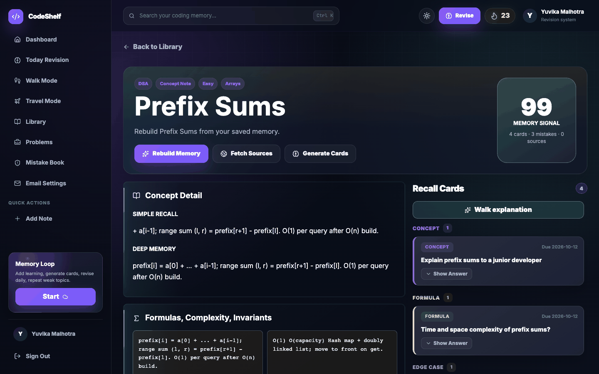
      <h3>🤖 AI concept memory</h3>
      Gemini generates six typed cards per note — concept, why, complexity, edge case, code recall, interview — and a branching recall chat grounded in <i>your</i> notes, mistakes and Wikipedia context.
    </td>
    <td width="50%" valign="top">
      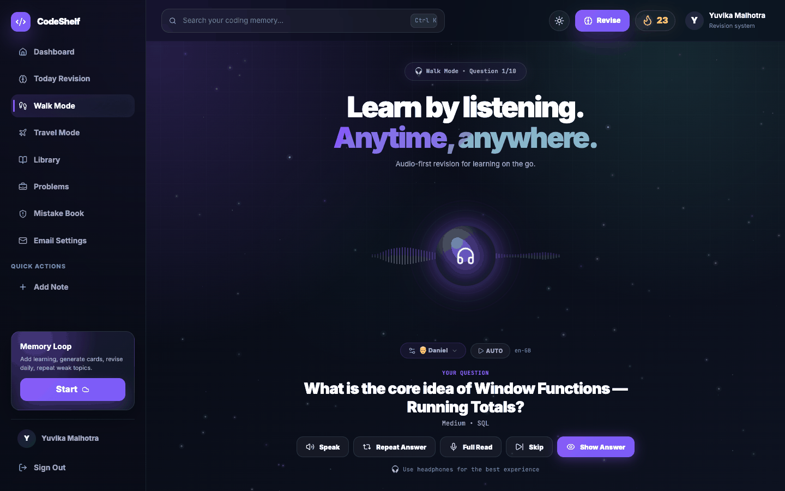
      <h3>🎧 Walk mode</h3>
      Audio-first revision with voice selection and auto-play — learn DSA on a walk. Travel mode packs cards into local storage for offline review and syncs ratings when you're back online.
    </td>
  </tr>
  <tr>
    <td width="50%" valign="top">
      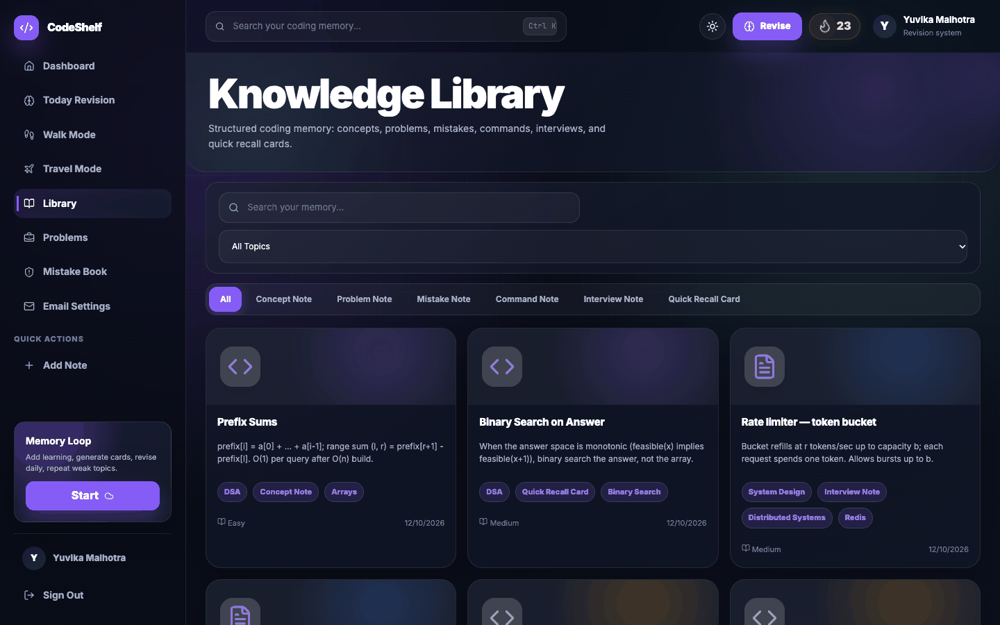
      <h3>📚 Knowledge library</h3>
      Concept, problem, mistake, command, interview and quick-recall notes with tag, topic and full-text search, a CodeMirror editor, and LLM-JSON card import.
    </td>
    <td width="50%" valign="top">
      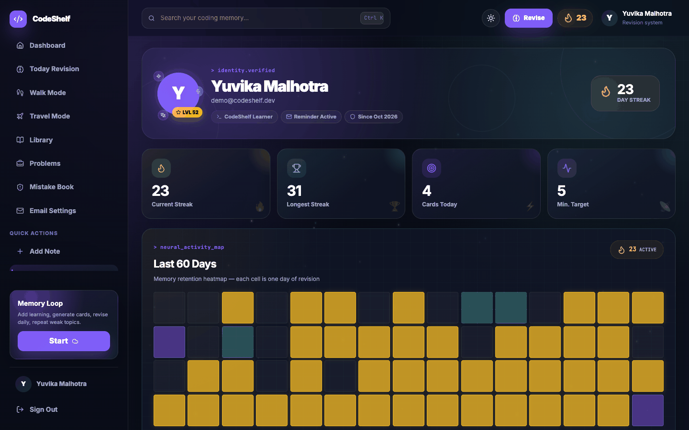
      <h3>🔥 Streaks &amp; activity map</h3>
      A day counts once you clear five cards. Current/longest streak and a 60-day activity heatmap keep the habit honest.
    </td>
  </tr>
  <tr>
    <td width="50%" valign="top">
      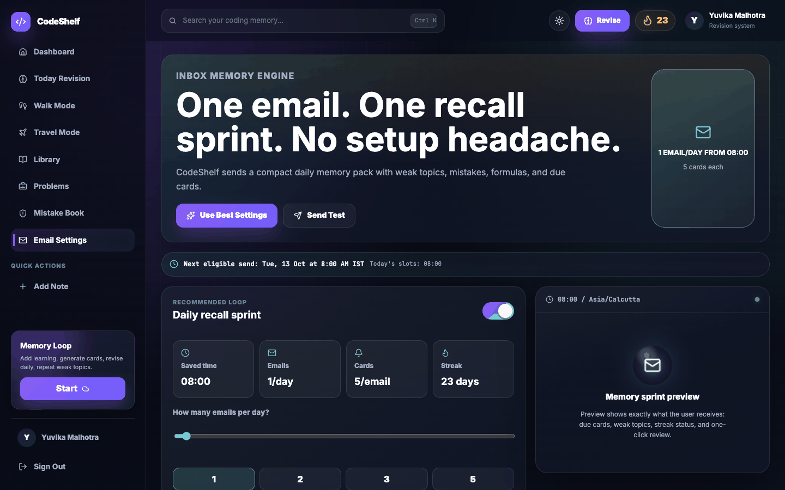
      <h3>📬 Inbox recall sprints</h3>
      Verified-email reminders with multiple-choice questions you can answer <i>from the email</i>, signed one-click review links, weekly digests and streak alerts.
    </td>
    <td width="50%" valign="top">
      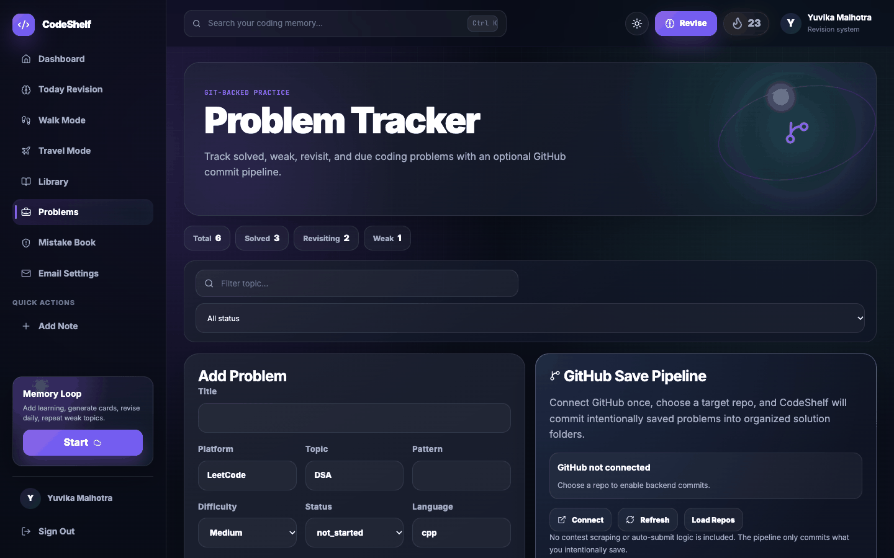
      <h3>💻 Problem tracker + GitHub sync</h3>
      Track LeetCode problems by pattern and status; the Chrome and VS Code extensions capture solutions and commit them to your GitHub repo with a generated README.
    </td>
  </tr>
</table>

<sub>Screens captured from a local instance seeded with demo data.</sub>

<br/>

## 🏗 Architecture


| Layer | Stack |
|:--|:--|
| **Frontend** | React 19, Vite 8, React Router 7, CodeMirror 6, Lucide, custom canvas nebula + cursor design system — deployed on **Vercel** |
| **Backend** | FastAPI (async), SQLAlchemy 2 async, Alembic (10 migrations), Pydantic settings — deployed on **Render** |
| **Data** | Neon serverless PostgreSQL (SQLite for local dev) — 15 tables |
| **AI** | Gemini (typed card generation, recall chat, email intros), Hugging Face Space summaries, offline fallbacks |
| **Clients** | Web app · Chrome MV3 extension · VS Code extension · Expo mobile app |
| **Ops** | GitHub Actions cron (daily / weekly / streak / cleanup), health checks, cold-start-aware retries |

<br/>

## 🔬 Engineering highlights

<details open>
<summary><b>Spaced-repetition scheduler</b></summary>
<br/>

| Rating | Next interval | Memory strength |
|:--|:--|:--|
| Forgot / Again | 1 day | −0.25 |
| Hard | +1 day (min 2) | +0.05 |
| Good | +4 days (min 4) | +0.18 |
| Easy | ×2 (min 7) | +0.30 |

Weak topics are mined from `forgot`/`hard` review logs and fed back into the dashboard, the revision queue and the daily email.
</details>

<details>
<summary><b>Security</b></summary>
<br/>

- JWT auth with bcrypt password hashing and strict email/password validation.
- Email verification and every email action link are **signed, expiring, purpose-scoped JWTs** bound to the account email.
- GitHub OAuth tokens are **Fernet-encrypted at rest** through a SQLAlchemy `TypeDecorator`, with a data migration for existing rows.
- Extension pairing uses **single-use, SHA-256-hashed codes** consumed atomically (`DELETE … RETURNING`) — the long-lived token never crosses `postMessage`.
- Cron endpoints require a shared secret (constant-time compare) and refuse to run in production without one; production refuses to boot with the default JWT secret.
</details>

<details>
<summary><b>AI pipeline that never breaks the UX</b></summary>
<br/>

- Gemini is prompted for strict JSON (six typed cards); responses are de-fenced, boundary-extracted, trailing-comma-repaired and validated card by card.
- Hugging Face summaries run with a 10s budget and fall back to an extractive summary.
- Every AI feature has a deterministic fallback, so the app works with zero API keys.
</details>

<details>
<summary><b>Free-tier engineering</b></summary>
<br/>

- Render's free tier blocks outbound SMTP, so mail goes through a pluggable `mailer` — a Google Apps Script **Gmail relay over HTTPS** (shared-secret guarded), Brevo, or Resend.
- Scheduled jobs run on **GitHub Actions** instead of paid cron: a reusable workflow wakes the sleeping instance, retries transient failures, and fails loudly only on real misconfiguration.
- Email sends are slot-based per user timezone with duplicate protection, so a cron firing every 30 min never double-sends.
</details>

<br/>

## 🚀 Run it locally

**Prerequisites:** Node ≥ 18, Python ≥ 3.11. Works out of the box with SQLite — add a `.env` in the repo root only to configure the variables below.

```bash
git clone https://github.com/Yuvika687/CodeShelf.git && cd CodeShelf
npm install
pip install -r backend-py/requirements.txt
npm run migrate      # Alembic → SQLite (or Neon if DATABASE_URL is set)
npm run dev:api      # FastAPI  → http://127.0.0.1:8000/api   (health: /api/health)
npm run dev          # React    → http://127.0.0.1:5173
```

<details>
<summary><b>Environment variables</b></summary>
<br/>

| Variable | Purpose |
|:--|:--|
| `DATABASE_URL` | `postgresql+asyncpg://…neon.tech/db?sslmode=require` (defaults to SQLite) |
| `JWT_SECRET` | Token signing — **required** in production |
| `FRONTEND_URL` / `BACKEND_URL` | Public URLs used in redirects and email links |
| `ENVIRONMENT` | `production` enables strict checks |
| `CRON_SECRET` | Shared secret for `/api/email/cron-*` (also a GitHub Actions secret) |
| `GMAIL_SCRIPT_URL` / `GMAIL_SCRIPT_SECRET` | Gmail relay ([`tools/gmail-relay`](tools/gmail-relay/Code.gs)) |
| `BREVO_API_KEY` + `MAIL_FROM_EMAIL` · `RESEND_API_KEY` | Alternative email providers |
| `GEMINI_API_KEY` · `HF_API_KEY` · `HF_SPACE_ID` | AI features (optional) |
| `GITHUB_CLIENT_ID` / `GITHUB_CLIENT_SECRET` | GitHub sync (optional) |
| `TOKEN_ENCRYPTION_KEY` | Key for stored GitHub tokens (defaults to one derived from `JWT_SECRET`) |
</details>

<details>
<summary><b>Project structure</b></summary>
<br/>

```
CodeShelf/
├── src/                     React app — pages, layout, nebula/cursor components, API client
├── backend-py/
│   ├── app/
│   │   ├── routes/          auth · notes · problems · mistakes · revision · concepts
│   │   │                    email · github · extension · dashboard · activity · ai
│   │   ├── models/          SQLAlchemy models (15 tables)
│   │   ├── mailer.py        Gmail relay / Brevo / Resend delivery
│   │   ├── crypto.py        at-rest encryption for third-party tokens
│   │   ├── ai_service.py    Gemini card generation + JSON repair
│   │   └── github_utils.py  OAuth, repo listing, solution commits
│   ├── alembic/             10 migrations
│   └── render.yaml          Render blueprint
├── extensions/              Chrome (MV3) + VS Code extensions
├── mobile/                  Expo / React Native app
├── tools/gmail-relay/       Google Apps Script mail relay
└── .github/workflows/       scheduled email jobs
```
</details>

<details>
<summary><b>Extensions &amp; mobile</b></summary>
<br/>

- **Chrome** — load `extensions/chrome` unpacked (or the zip in `public/downloads`), click *Connect CodeShelf*, then *Capture current page* on any LeetCode problem. See [EXTENSIONS.md](EXTENSIONS.md).
- **VS Code** — open `extensions/vscode`, press <kbd>F5</kbd>, run `CodeShelf: Connect` / `Save Current File` / `Commit Current File to GitHub`.
- **Mobile** — `cd mobile && npm install && npm start`, scan the QR code with Expo Go.
</details>

<br/>

## 🌐 Deployment

| Piece | Where | Notes |
|:--|:--|:--|
| Frontend | **Vercel** | `VITE_API_BASE_URL=https://<api>.onrender.com/api` |
| API | **Render** (`backend-py/render.yaml`) | build runs `alembic upgrade head` |
| Database | **Neon** | serverless Postgres |
| Scheduled email | **GitHub Actions** | add repo secret `CRON_SECRET` (same value as the API) |

<br/>

<div align="center">

**Built by [Yuvika Malhotra](https://github.com/Yuvika687)** · [LinkedIn](https://linkedin.com/in/yuvikamalhotra) · [Email](mailto:yuvikamalhotra1414@gmail.com)

<sub>© 2026 Yuvika Malhotra. All rights reserved.</sub>

</div>
